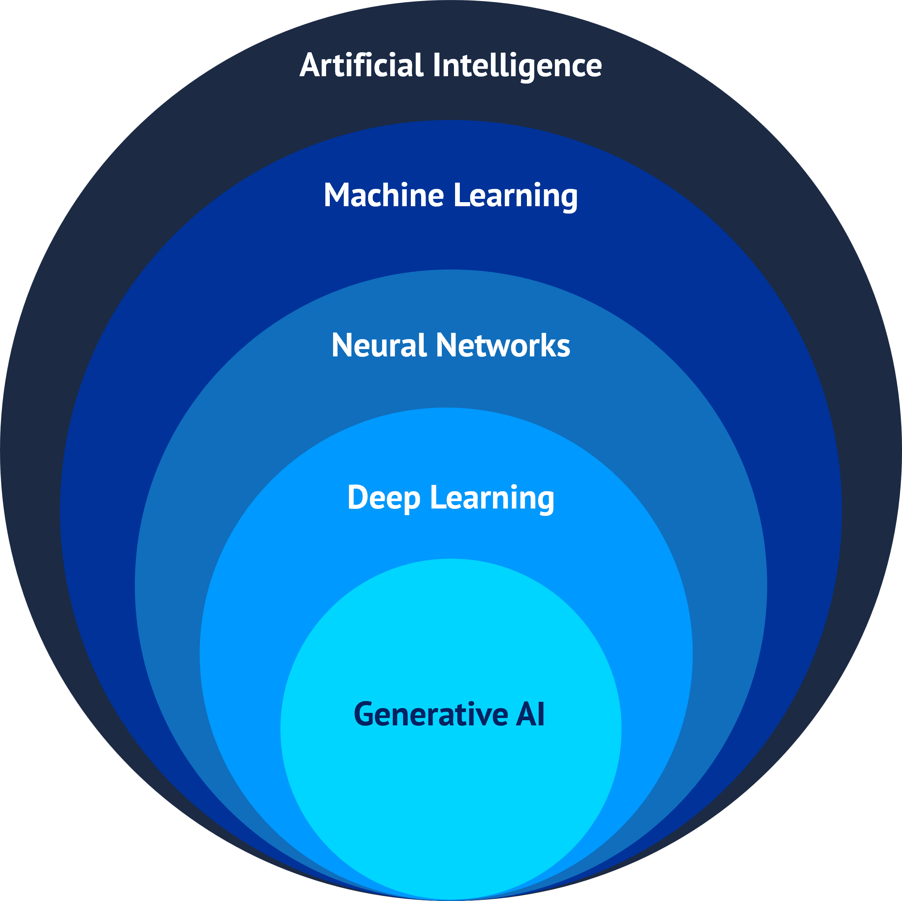
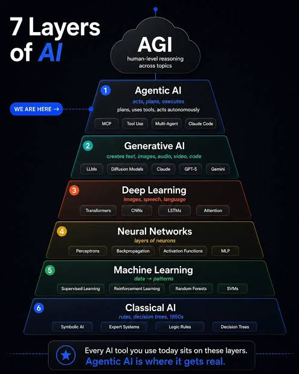

# Machine-Learning-Guide

A hands-on guide to essential Machine Learning algorithms and their deployment to production

## Objective

This guide pretends to be a step-by-step guide to learn how to implement fundamental Machine Learning algorithms from scratch.

When I first started searching information about machine learning myself, I often came across implementations that were either complex or not at all intuitive. This made it harder to understand the fundamentals. I hope this guide will serve as a go-to resource for building a mental picture of the most relevant algorithms and their basic implementations, as well as for gaining a clear understanding of the most common pipelines.

**Note that these implementations are, for the most part, projects for beginners with learning purposes. They are not production implementations (a chapter on deploying to production will be added later).**

## What is Machine Learning?

As you search _"what is Machine Learning"_ on the Internet, you realize that there are plenty of different definitions. However, most of them agree on some terms.

Fundamentally, Machine Learning is a branch of Artificial Intelligence that studies **algorithms that can learn patterns from data**. Once learned the patterns, they take decisions and **make predictions**.

Actually, machine learning is a key field with implementations in nearly every sector.

## Artificial Intelligence vs Machine Learning

Even if they are sometimes used indistinctively, **AI and ML are not the same thing**. As Machine Learning, there are several definitions for Artificial Intelligence, but keeping it simple, AI stands for a more general concept than Machine Learning. In other words, Artificial Intelligence includes Machine Learning, but also Deep Learning and Generative AI.

## The 7 layers of AI. Where we are?

Although many people think otherwise, artificial intelligence is a field that has been around for many years and has been used in a wide range of fields for many decades.

The first references to artificial intelligence appeared in the 1950s and 1960s, with figures such as **Alan Turing**.

However, until just a few years ago, artificial intelligence was virtually unknown to the general public. Despite its long history, it wasn’t until 2020—with OpenAI’s release of **GPT-3**—that people began to realize what artificial intelligence was and what its potential was. Nevertheless, this revolution had begun somewhat earlier in the industry. Specifically in 2017, with the release of what is likely the most influential paper in the field of artificial intelligence, **“Attention Is All You Need”**, written by Google Brain (now Google DeepMind), which introduced the **Transformer architecture**.

Since then, AI has advanced at an extremely rapid pace, and a **7-layer model** has been established to describe the composition of Artificial Intelligence.

The launch of GPT-3 ushered in the era of Generative AI, with the constant release of increasingly better and faster LLMs.

However, in recent years, the AI frontier has begun to shift toward **Agentic AI**. The way I like to look at it is this: if we were to view Artificial Intelligence as a person, until now the AI sector had been focused on improving the brain. Now, however, it is focusing on giving it hands and feet, that is, tools to use its brain to perform tasks.

In short, until now, AI could only think, and in the coming years, everything points to AI development being focused on **enabling AI to act**.

## Machine Learning Scheme

Machine learning is a broad field that is divided into **three major branches**:

- Supervised Learning
- Unsupervised Learning
- Reinforcement Learning

### Supervised Learning

Supervised learning is a ML technique that trains the algorithm using **labeled data**. It should be used when **you have the answers** to the predictions you need to do.

Depending on the nature of the problem, the aim is different.

#### Classification

When you need to divide data into different classes or groups, you use a classification model. As an example, taking your emails and divide them into spam and not spam.

The main algorithms for classification are:

- KNN (K-Nearest Neighbours)
- Decision Trees
- Support Vector Machines (SVMs)
- Random Forest
- Gradient Boosting
- Neural Networks (Deep Learning)

The main metrics for evaluating classification models are:

- Accuracy
- Precission
- Recall
- F1 Score
- Confussion Matrix

#### Regression

When you need to predict a numeric value (or a continuos one), yo use a regression model. As an example, predicting the price of houses.

The main algorithms for regression are:

- Linear regression (with regularization Ridge and Lasso)
- Polinomic regression
- Decision trees for regression
- Ensembles
- Gradient Boosting
- Support Vector Regression (SVR)

The main metrics for evaluating regression models are:

- Mean Squared Error (MSE)
- Root Mean Squared Error (RMSE)
- Mean Absolute Error (MAE)

### Unsupervised Learning

Unsupervised Learning is a ML technique that trains the algorithm with **unlabeled data**. It should be used when **you do not have the correct answers** to the predictions.

Depending on the problem, the type of model you should use is different.

#### Clustering

When you need to **create groups** of data **without saying (or knowing) those groups are beforehand**, you use clustering. As an example, using clustering for market segmentation.

The main algorithms for clustering are:

- K-Means
- K-Medoids
- Hierarchical clustering
- DBSCAN
- Gaussian Mixture Models (GMM)
- Spectral clustering

The main metrics for evaluating clustering models (that do not depend on labels) are:

- Manhattan Distance
- Euclidean Distance
- Minkowski Distance
- Shilouette Score
- Davies-Bouldin Index
- Adjust Rand Index (ARI)
- Purity

#### Dimension reduction and Feature extraction

When you need to transform a dataset into another one smaller with less features or into a smaller one, you use dimension reduction and feature extraction

The main algorithms for dimension reduction and Feature extraction are:

- Principal Components Analysis (PCA)
- Non-Negative Matrix Factorization (NMF)
- Autoencoders
- t-Distributed Stochastic Neighbor Embedding (t-SNE)
- Uniform Manifold Approximation and Projection (UMAP)

### Reinforcement Learning

Reinforcement Learning is a ML technique that involves an autonomous agent taking decisions by itself by improving due to trial and error, through an optimal policy.

The main algorithms for reinforcement learning are:

- Dynamic Programming
- Monte Carlo Tree Search (MCTS)
- Dyna-Q
- Q-Learning
- SARSA

## Pipeline

Building a Machine Learning Model involves a sequence of steps where the output of one step is the input of the following. This is called **pipeline**.

A pipeline for building a Machine Learning Model from scratch could be:

### 1. Data ingestion

Obtain raw data from one or more sources such as databases, CSVs...

### 2. Exploratory Data Analysis (EDA)

You must understand the data for knowing how data behaves.

### 3. Data spplitting

If you are doing supervised learning, you must split your data into the data you are going to use to train the model and the one that you are going to use to test how good the model is

> [!TIP]
> In real implementations, train/test method have some problems such as introducing bias in the data. It is much better using **cross validation**, where you split the data through iterations and introduce validation for adjusting hyperparameters.

### 4. Data preprocessing

This process includes deleting innecesary data, imputation, scaling and normalizing, one-hot encoding... In general, any treatment that makes the data better for the model and avoids innecesary information.

> [!WARN]
> You must be careful with data imputation. For example, if you are assigning the mean of a column to null values, you must compute the mean only with train values. Otherwise, you might have **data leakage**.

### 5. Feature engineering

After understanding the problem and the data with EDA, you might notice that some useful features are missing. You can add them, just as you can erase noise and redundance.

### 6. Model training and hyperparameter tuning

The model is trained with the train data while hyperparemters are optimized with the validation set. **Cross validation** is highly recommended here

> [!NOTE]
> A hyperparameter is any kind of configuration value of the algorithm that has to be set manually.

### 7. Model evaluation

Use appropiate metrics to determine how good the model performs with test data.

If the metrics are not good enough, diagnose the problem and fix it.

### 8. Use all the data available

The metrics in the last point are a pesimist ones. Once you have good scores, the final model will be, at least, as good as the one the metrics show, but you can train the model with test + train data now. That way,

**Final Model = Model trained with 100% of the data + optimized parameters**

This is, the algorithm + weights + optimized hyperparameters.

### 9. Deploy the model to production

Now you have to turn this pipeline into something that can be deployed and executed. You may export to efficient formats, serve the service as an API...

### 10. Monitoring

The pipeline does not finish with deployment. Machine Learning models need continuous monitoring. Some problems and issues can occur after deploying the model. As an example, a famous one is **data drift**, that occurs when the data distribution changes with the new data.
